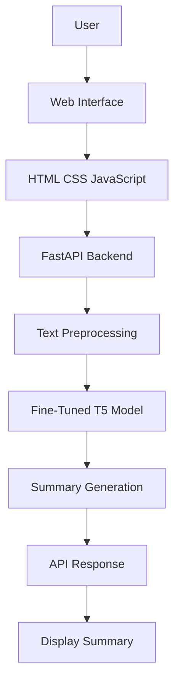

# 📝 T5 Text Summarizer

An end-to-end Natural Language Processing (NLP) application that generates concise and meaningful summaries from lengthy text using a fine-tuned **T5 (Text-to-Text Transfer Transformer)** model.

The application integrates a fine-tuned Hugging Face Transformer model with a **FastAPI backend** and an interactive web interface built using HTML, CSS, and JavaScript.

The model was fine-tuned using Google Colab, saved locally, and integrated into the application for text summarization.

---

## ✨ Features

- 🤖 AI-powered text summarization
- 🧠 Fine-tuned Hugging Face T5 Transformer model
- 📄 Generates concise summaries from lengthy text
- ⚡ FastAPI backend for model inference
- 🌐 Interactive web interface
- 🔗 Frontend and backend integration
- 💾 Local model loading and inference
- 🚀 Real-time summary generation

## 🛠️ Tech Stack

| Technology | Purpose |
|---|---|
| Python | Backend development |
| PyTorch | Deep learning framework |
| Hugging Face Transformers | Model loading and fine-tuning |
| T5 Transformer | Text summarization |
| Google Colab | Model training and fine-tuning |
| FastAPI | Backend API |
| Uvicorn | API server |
| HTML | Web page structure |
| CSS | Frontend styling |
| JavaScript | Frontend interaction |
| Git & GitHub | Version control |

## 🏗️ Project Architecture

The application follows a client-server architecture.



## 📂 Project Structure

```text
t5-text-Summarizer/
│
├── notebook/
│   └── Text_summarizer.ipynb
│
├── saved_summary_model/
│   ├── config.json
│   ├── generation_config.json
│   ├── model.safetensors
│   ├── special_tokens_map.json
│   ├── tokenizer_config.json
│   └── tokenizer.json
│
├── app.py
├── index.html
├── requirements.txt
├── README.md
└── .gitignore
```

## 🧠 Model Training

The pretrained Hugging Face T5 model was fine-tuned using Google Colab for the text summarization task.

### Training Workflow

1. Load the pretrained T5 model and tokenizer.
2. Prepare and preprocess the summarization dataset.
3. Tokenize input text and target summaries.
4. Fine-tune the model using Google Colab.
5. Save the trained model and tokenizer.
6. Integrate the saved model into the FastAPI application.
7. Generate summaries from user-provided text.

### Model Integration

The fine-tuned model is stored locally in the `saved_summary_model/` directory.

The FastAPI application loads the saved model and tokenizer for inference. The model does not need to be retrained every time the application runs.

## ⚙️ Installation and Setup

### Prerequisites

- Python 3.10 or a compatible version
- pip
- Git

### 1. Clone the Repository

```bash
git clone https://github.com/buttam18-pja/t5-text-Summarizer.git
```

### 2. Navigate to the Project Directory

```bash
cd t5-text-Summarizer
```

### 3. Create a Virtual Environment

```bash
python -m venv venv
```

### 4. Activate the Virtual Environment

**Windows:**

```bash
venv\Scripts\activate
```

**Linux / macOS:**

```bash
source venv/bin/activate
```

### 5. Install Dependencies

```bash
pip install -r requirements.txt
```

### 6. Verify Model Files

Ensure that the `saved_summary_model/` directory exists and contains the trained model weights and tokenizer configuration.

If the model files are hosted separately, download them and place them in the expected directory.

## 🚀 Run the Application

Start the FastAPI development server:

```bash
uvicorn app:app --reload
```

Open your browser:

```text
http://127.0.0.1:8000
```

## 📄 How to Use

1. Start the FastAPI application.
2. Open the web interface in your browser.
3. Enter or paste the text you want to summarize.
4. Submit the input text.
5. The backend processes the text using the fine-tuned T5 model.
6. View the generated summary on the web interface.

## 🔌 API Documentation

FastAPI provides interactive API documentation when the application is running.

**Swagger UI:**

```text
http://127.0.0.1:8000/docs
```

### Summarization API

The application uses a summarization endpoint.

**Endpoint:**

```http
POST /summarize/
```

**Example Request:**

```json
{
  "dialogue": "Enter the text you want to summarize."
}
```

**Example Response:**

```json
{
  "summary": "Generated summary of the input text."
}
```

*Note: The endpoint, request fields, and response structure should match the implementation in `app.py`.*

## 📓 Model Training Notebook

The model training notebook is available in:

```text
notebook/Text_summarizer.ipynb
```

It contains the workflow for:

- Loading the pretrained T5 model and tokenizer.
- Preparing the summarization dataset.
- Tokenizing input and target text.
- Fine-tuning the Transformer model.
- Saving the trained model and tokenizer.
- Preparing the model for application integration.

## 🔮 Future Improvements

- Improve summarization quality through additional fine-tuning.
- Evaluate model performance using ROUGE metrics.
- Add PDF and TXT document upload support.
- Implement configurable summary lengths.
- Improve handling of longer input documents.
- Optimize model inference speed and memory usage.
- Improve the frontend user experience.
- Deploy the application to a cloud platform.

## 🎯 Learning Outcomes

This project provided practical experience in:

- Fine-tuning Transformer models for NLP tasks.
- Understanding the T5 architecture.
- Using Hugging Face Transformers and PyTorch.
- Preparing text for NLP model training.
- Saving and loading fine-tuned models.
- Building backend APIs using FastAPI.
- Integrating ML models with web applications.
- Developing frontend interfaces using HTML, CSS, and JavaScript.

## 👨‍💻 Author

**Uttam SB**

Aspiring AIML engineer 

- GitHub: [@buttam18-pja](https://github.com/buttam18-pja)

## 📜 License

This project is intended for educational and learning purposes.

The pretrained model, dataset, and third-party libraries used in this project are subject to their respective licenses.
