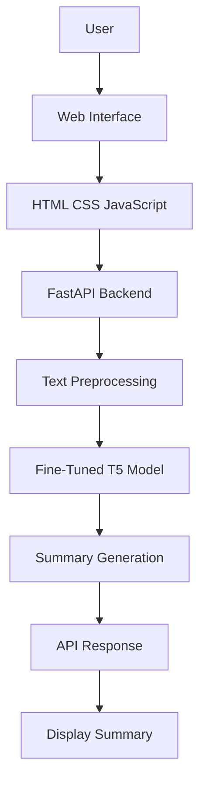

# 📝 T5 Text Summarizer

<<<<<<< HEAD
An AI-powered text summarization application built using a fine-tuned Hugging Face T5 (Text-to-Text Transfer Transformer) model. The application converts lengthy text into concise, meaningful summaries through an interactive web interface.

The pretrained T5 model was fine-tuned using Google Colab and integrated into a FastAPI backend with an HTML, CSS, and JavaScript frontend.
=======
An AI-powered text summarization application built using a fine-tuned **Hugging Face T5 (Text-to-Text Transfer Transformer)** model. The application converts lengthy text into concise, meaningful summaries through an interactive web interface.

The pretrained T5 model was fine-tuned using **Google Colab** and integrated into a **FastAPI backend** with an HTML, CSS, and JavaScript frontend.
>>>>>>> origin/main

## ✨ Features

- 🤖 AI-powered text summarization
- 🧠 Fine-tuned Hugging Face T5 transformer model
- 📄 Generates concise summaries from input text
- ⚡ FastAPI backend integration
- 🌐 Interactive web interface
- 🔗 Frontend and backend integration
- 🚀 Real-time summary generation through the web application

## 🛠️ Tech Stack

<<<<<<< HEAD
Technology| Purpose
Python| Backend development
PyTorch| Deep learning framework
Hugging Face Transformers| Pretrained model and fine-tuning
T5 Transformer| Text summarization
Google Colab| Model training and fine-tuning
FastAPI| Backend API
HTML| Web page structure
CSS| Frontend styling
JavaScript| Frontend interaction and API requests
=======
| Technology | Purpose |
|---|---|
| Python | Backend development |
| PyTorch | Deep learning framework |
| Hugging Face Transformers | Pretrained model and fine-tuning |
| T5 Transformer | Text summarization |
| Google Colab | Model training and fine-tuning |
| FastAPI | Backend API |
| HTML | Web page structure |
| CSS | Frontend styling |
| JavaScript | Frontend interaction and API requests |
>>>>>>> origin/main

## 🧠 Model Training

The pretrained Hugging Face T5 model was fine-tuned using Google Colab for the text summarization task.

<<<<<<< HEAD
Training Workflow
=======
### Training Workflow
>>>>>>> origin/main

1. Load the pretrained T5 model and tokenizer.
2. Prepare and preprocess the text summarization dataset.
3. Fine-tune the model using Google Colab.
4. Save the trained model and tokenizer.
5. Integrate the saved model into the FastAPI application.
6. Generate summaries from user-provided text.

The fine-tuned model is loaded locally by the FastAPI application for inference.

## 📂 Project Structure

<<<<<<< HEAD
=======
```text
>>>>>>> origin/main
text-summarizer/
│
├── app.py
├── index.html
<<<<<<< HEAD
├── frontend/
=======
|__ notebook
>>>>>>> origin/main
│
├── saved_summary_model/
│   ├── config.json
│   ├── model files
│   └── tokenizer files
│
├── requirements.txt
├── README.md
└── .gitignore
<<<<<<< HEAD

## ⚙️ Installation

1. Clone the Repository

git clone YOUR_GITHUB_REPOSITORY_URL

2. Navigate to the Project Directory

cd text-summarizer

3. Create a Virtual Environment

python -m venv venv

4. Activate the Virtual Environment

Windows:

venv\Scripts\activate

Linux / macOS:

source venv/bin/activate

5. Install Dependencies

pip install -r requirements.txt

## 🚀 Run the Application

Start the FastAPI development server:

uvicorn app:app --reload

Open your browser and visit:

http://127.0.0.1:8000

## 📄 How to Use

1. Open the application in your browser.
2. Enter or paste the text you want to summarize.
3. Submit the text through the summarization interface.
4. The FastAPI backend processes the input using the fine-tuned T5 model.
5. View the generated summary on the web interface.

## 🔌 API Endpoint

Generate Summary

Endpoint:

POST /summarize/

Request Body:

{
  "dialogue": "Enter the text you want to summarize."
}

Response:

{
  "summary": "Generated summary of the input text."
}

## 🔮 Future Improvements

- 📈 Improve summarization quality
- ⚡ Optimize model inference speed
- 📏 Support longer input texts
- 🌍 Deploy the application online
- 🎨 Improve the user interface
- 📊 Evaluate summarization performance using appropriate metrics

## 👨‍💻 Author

Your Name

- GitHub: sbuttam18-pja/t5-text-Summarizer

## 📜 License

This project is intended for educational and learning purposes. Add an appropriate license before distributing the project.
=======
# AI Text Summarizer using Fine-Tuned T5 Transformer

An end-to-end Natural Language Processing (NLP) application that generates concise and meaningful summaries from lengthy text using a fine-tuned **T5 (Text-to-Text Transfer Transformer)** model.

The application integrates a fine-tuned Hugging Face Transformer model with a FastAPI backend and an interactive web interface built using HTML, CSS, and JavaScript.

The model was fine-tuned using Google Colab, saved locally, and integrated into the application for text summarization.

---

## Overview

The objective of this project is to develop an AI-powered text summarization system that reduces lengthy text into shorter summaries while preserving its essential information.

The application allows users to submit text through a web interface, process it using a locally saved fine-tuned T5 model, and receive a generated summary.

This project demonstrates the development of an end-to-end machine learning application, covering model fine-tuning, model serialization, backend integration, and frontend development.

## Features

- **AI-Powered Text Summarization:** Generates concise summaries from user-provided text.
- **Fine-Tuned T5 Transformer:** Uses a fine-tuned Hugging Face T5 model for abstractive summarization.
- **Custom Model Integration:** Loads the locally saved fine-tuned model and tokenizer.
- **FastAPI Backend:** Handles summarization requests and model inference.
- **Interactive Web Interface:** Provides a simple interface for entering text and viewing summaries.
- **Frontend Integration:** Built using HTML, CSS, and JavaScript.
- **Local Model Inference:** Uses the saved model for generating summaries without relying on an external summarization API.
- **End-to-End NLP Application:** Integrates model training, inference, backend processing, and frontend interaction.

## Tech Stack

| Category | Technology |
|---|---|
| Programming Language | Python |
| Deep Learning Framework | PyTorch |
| NLP Framework | Hugging Face Transformers |
| Transformer Architecture | T5 |
| Backend Framework | FastAPI |
| Frontend | HTML, CSS, JavaScript |
| API Server | Uvicorn |
| Model Training | Google Colab |
| Development Environment | VS Code |
| Version Control | Git and GitHub |

## Project Architecture

The application follows a simple client-server architecture.



### Workflow

1. The user enters text into the web interface.
2. JavaScript sends the text to the FastAPI backend.
3. The backend preprocesses the input.
4. The fine-tuned T5 model generates a summary.
5. The generated summary is returned to the frontend.
6. The frontend displays the summary to the user.

## Project Structure

```text
text_summarizer/
│
├── notebook/
│   └── Text_summarizer.ipynb
│
├── saved_summary_model/
│   ├── config.json
│   ├── generation_config.json
│   ├── model.safetensors
│   ├── tokenizer_config.json
│   └── tokenizer.json
│
├── app.py
├── index.html
├── requirements.txt
├── README.md
└── .gitignore
```

### Directory Description

| File / Directory | Description |
|---|---|
| `app.py` | FastAPI application responsible for loading the model and handling summarization requests. |
| `index.html` | Frontend interface for entering text and displaying summaries. |
| `notebook/` | Contains the Google Colab training and fine-tuning notebook. |
| `saved_summary_model/` | Contains the fine-tuned model weights and tokenizer configuration. |
| `config.json` | Stores the model architecture configuration. |
| `generation_config.json` | Stores the model's text-generation configuration. |
| `model.safetensors` | Contains the saved fine-tuned model weights. |
| `tokenizer_config.json` | Stores tokenizer configuration. |
| `tokenizer.json` | Contains the tokenizer vocabulary and processing configuration. |
| `requirements.txt` | Lists the Python dependencies required by the application. |
| `.gitignore` | Specifies files and directories excluded from Git tracking. |

## Model Information

### T5 (Text-to-Text Transfer Transformer)

T5 is a Transformer-based architecture developed by Google that converts NLP tasks into a text-to-text format.

This project uses a pretrained Hugging Face T5 model that was fine-tuned for text summarization.

### Model Training Process

The model training workflow was performed using Google Colab.

1. Load the pretrained T5 model and tokenizer.
2. Prepare the text summarization dataset.
3. Preprocess and tokenize the input text and target summaries.
4. Fine-tune the model using the training dataset.
5. Save the fine-tuned model and tokenizer.
6. Integrate the saved model into the FastAPI application.

### Model Integration

The fine-tuned model is saved locally in the `saved_summary_model/` directory.

The FastAPI application loads the saved model and tokenizer and uses them to generate summaries during inference.

The model is not retrained every time the application runs.

## Installation and Setup

### Prerequisites

Make sure the following are installed:

- Python 3.10 or a compatible version
- pip
- Git
- VS Code (recommended)

The fine-tuned model files must also be available locally.

### 1. Clone the Repository

```bash
git clone https://github.com/buttam18-pja/t5-text-Summarizer.git
```

Navigate to the project directory:

```bash
cd t5-text-Summarizer
```

### 2. Create a Virtual Environment
=======
```

## ⚙️ Installation

### 1. Clone the Repository

```bash
git clone YOUR_GITHUB_REPOSITORY_URL
```

### 2. Navigate to the Project Directory

```bash
cd text-summarizer
```

### 3. Create a Virtual Environment
>>>>>>> origin/main

```bash
python -m venv venv
```

<<<<<<< HEAD
Activate the virtual environment.
=======
### 4. Activate the Virtual Environment
>>>>>>> origin/main

**Windows:**

```bash
venv\Scripts\activate
```

**Linux / macOS:**

```bash
source venv/bin/activate
```

<<<<<<< HEAD
### 3. Install Dependencies

Install the required Python packages:
=======
### 5. Install Dependencies
>>>>>>> origin/main

```bash
pip install -r requirements.txt
```

<<<<<<< HEAD
### 4. Verify the Model Files

Ensure the following directory exists:

```text
saved_summary_model/
```

It should contain the fine-tuned model weights and tokenizer configuration.

If the model files are hosted separately, download them and place them in the expected directory before running the application.

### 5. Start the FastAPI Server

Run the following command from the project root:
=======
## 🚀 Run the Application

Start the FastAPI development server:
>>>>>>> origin/main

```bash
uvicorn app:app --reload
```

<<<<<<< HEAD
### 6. Open the Application

Open your browser and navigate to:
=======
Open your browser and visit:
>>>>>>> origin/main

```text
http://127.0.0.1:8000
```

<<<<<<< HEAD
If the frontend is configured to use a different route, open the route defined in `app.py`.

## Usage

1. Start the FastAPI application.
2. Open the web interface in your browser.
3. Enter the text you want to summarize.
4. Submit the input text.
5. The backend processes the text using the fine-tuned T5 model.
6. View the generated summary on the web interface.

## API Documentation

The application uses FastAPI to handle backend requests and model inference.

FastAPI provides interactive API documentation when the application is running.

### Swagger UI

```text
http://127.0.0.1:8000/docs
```

### API Workflow

```text
Input Text
    ↓
FastAPI Endpoint
    ↓
Text Preprocessing
    ↓
Fine-Tuned T5 Model
    ↓
Summary Generation
    ↓
JSON Response
```

The exact endpoint paths, request parameters, and response structure depend on the implementation in `app.py`.

## Model Training Notebook

The training notebook is available in:

```text
notebook/Text_summarizer.ipynb
```

The notebook contains the workflow used to fine-tune the pretrained T5 model.

### Training Workflow

- Load the pretrained model and tokenizer.
- Prepare the summarization dataset.
- Tokenize the input and target text.
- Fine-tune the Transformer model.
- Save the trained model.
- Save the tokenizer.
- Prepare the model for integration with the FastAPI application.

Google Colab was used for model fine-tuning.

## Technologies and Libraries

### Hugging Face Transformers

Used to load the pretrained T5 model, tokenize text, fine-tune the model, and generate summaries.

### PyTorch

Used as the deep learning framework for model training and inference.

### FastAPI

Used to build the backend API and connect the fine-tuned model with the web interface.

### HTML, CSS, and JavaScript

Used to develop the frontend interface and communicate with the backend.

### Uvicorn

Used to run the FastAPI application locally.

## Future Improvements

- Improve summarization quality through additional fine-tuning.
- Evaluate the model using ROUGE and other summarization metrics.
- Add support for PDF and TXT document uploads.
- Implement configurable summary lengths.
- Improve handling of long input documents.
- Add input validation and error handling.
- Optimize model inference time and memory usage.
- Improve the frontend user experience.
- Deploy the application to a cloud platform.
- Explore quantization and other model optimization techniques.

## Learning Outcomes

This project provided practical experience in:

- Fine-tuning Transformer models for NLP tasks.
- Understanding the T5 architecture.
- Using Hugging Face Transformers and PyTorch.
- Preparing text for NLP model training.
- Saving and loading fine-tuned models.
- Building backend APIs using FastAPI.
- Integrating machine learning models with web applications.
- Developing frontend interfaces using HTML, CSS, and JavaScript.
- Building an end-to-end AI application.

## Author

**Uttam SB**

Information Science Engineering Student

GitHub: [buttam18-pja](https://github.com/buttam18-pja)

## License

This project is intended for educational and learning purposes.

The pretrained model, dataset, and third-party libraries used in this project are subject to their respective licenses.
>>>>>>> ba7864d (add project documentation)
=======
## 📄 How to Use

1. Open the application in your browser.
2. Enter or paste the text you want to summarize.
3. Submit the text through the summarization interface.
4. The FastAPI backend processes the input using the fine-tuned T5 model.
5. View the generated summary on the web interface.

## 🔌 API Endpoint

### Generate Summary

**Endpoint:**

```text
POST /summarize/
```

**Request Body:**

```json
{
  "dialogue": "Enter the text you want to summarize."
}
```

**Response:**

```json
{
  "summary": "Generated summary of the input text."
}
```

## 🔮 Future Improvements

- 📈 Improve summarization quality
- ⚡ Optimize model inference speed
- 📏 Support longer input texts
- 🌍 Deploy the application online
- 🎨 Improve the user interface
- 📊 Evaluate summarization performance using appropriate metrics

## 👨‍💻 Author

**Your Name**

- GitHub: sbuttam18-pja/t5-text-Summarizer

## 📜 License

This project is intended for educational and learning purposes. Add an appropriate license before distributing the project.

>>>>>>> origin/main
